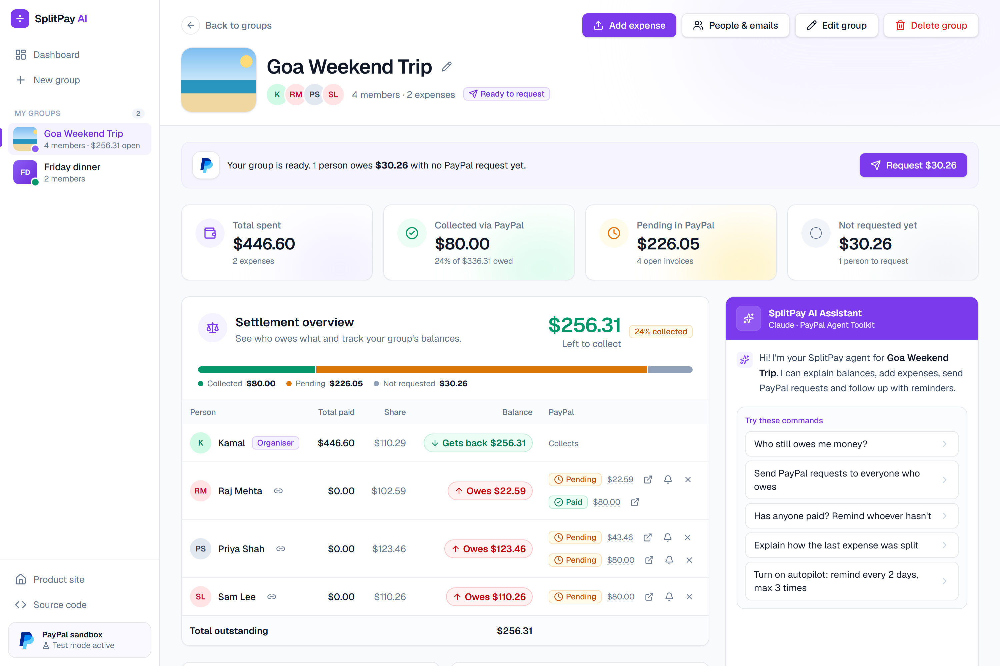
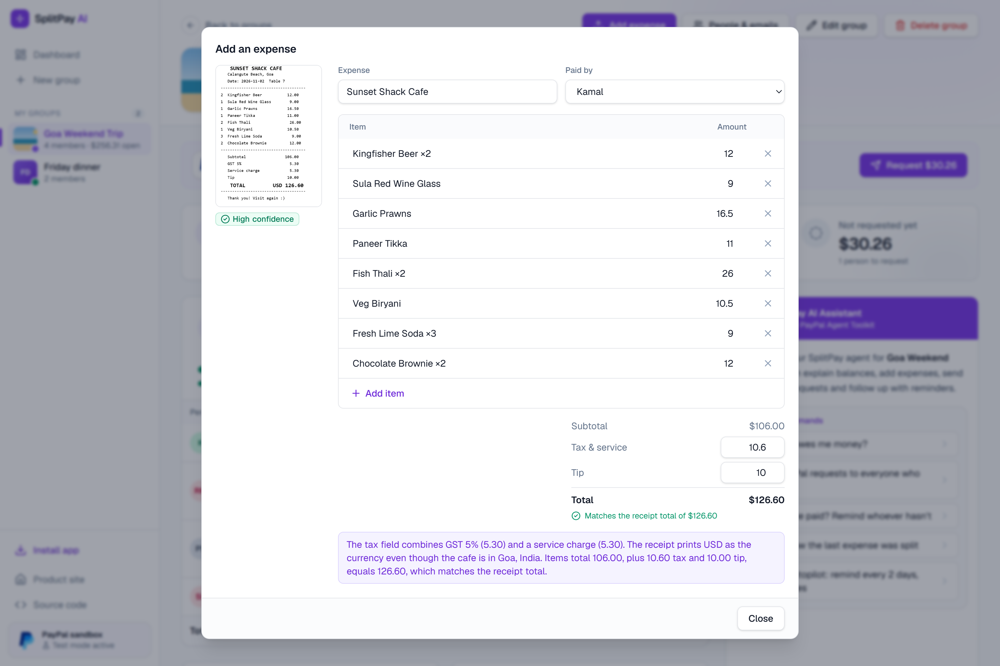
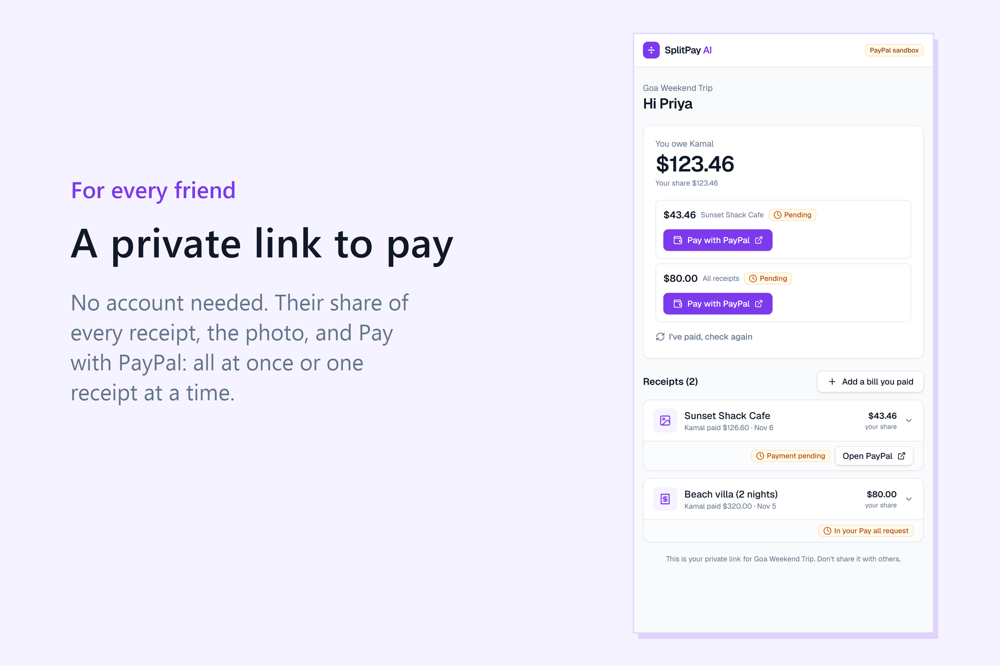
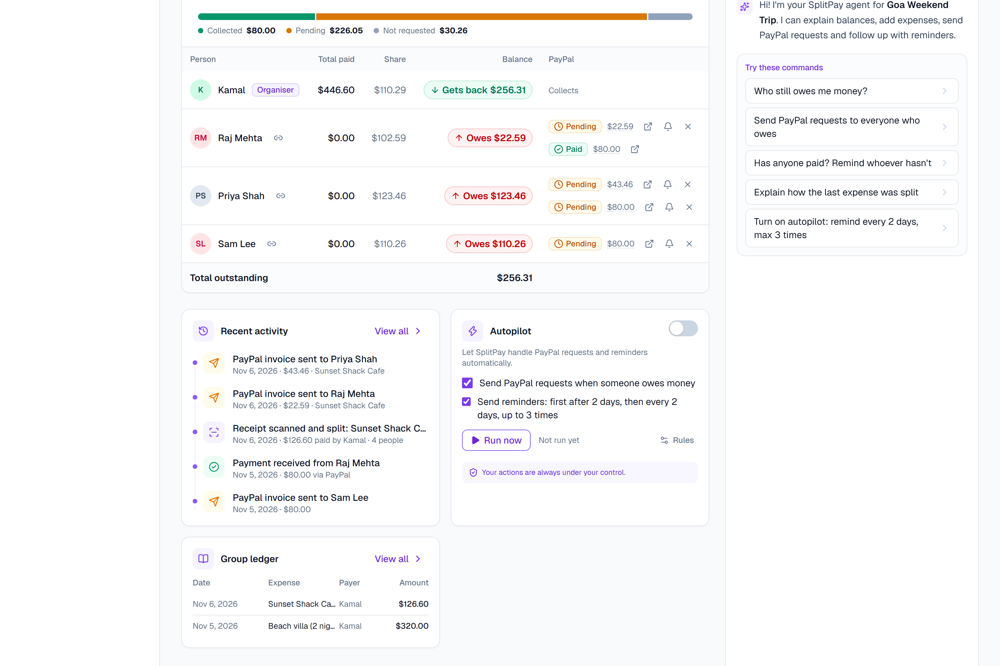
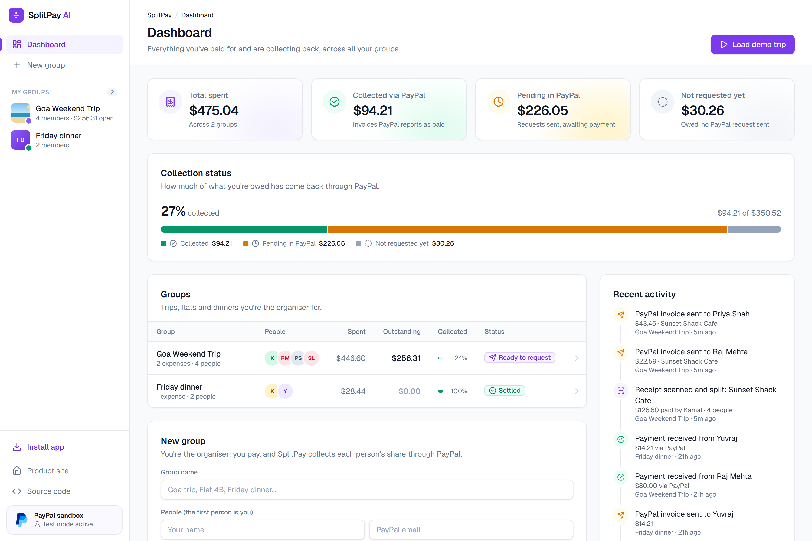

# SplitPay AI

**Snap the bill. AI settles it.**

SplitPay AI reads a receipt (or your group chat), understands how you want to split it in plain English, and uses an AI agent built on the **PayPal Agent Toolkit** to send everyone a PayPal invoice, track payments live through **PayPal webhooks**, and politely follow up until the group is settled.

> Built for the **PayPal AI Hackathon 2026**. Everything runs on the free PayPal **sandbox**; no real money moves.

**Live demo:** https://splitpay-ai-6ckm.onrender.com
**Demo video:** _YouTube link_



<table>
  <tr>
    <td width="50%"><br><sub>Claude reads every line of the receipt and checks it adds up</sub></td>
    <td width="50%"><br><sub>Each friend gets a private link to view receipts and pay with PayPal</sub></td>
  </tr>
  <tr>
    <td width="50%"><br><sub>Real-time activity, rule-based Autopilot and the group ledger</sub></td>
    <td width="50%"><br><sub>Dashboard: what's collected via PayPal and what's still pending</sub></td>
  </tr>
</table>

---

## Contents

- [The problem](#the-problem)
- [What it does](#what-it-does)
- [How PayPal is used](#how-paypal-is-used)
- [How AI is used](#how-ai-is-used)
- [Sponsor tools](#sponsor-tools)
- [Guardrails](#guardrails)
- [Testing instructions for judges](#testing-instructions-for-judges)
- [Run it locally](#run-it-locally)
- [Deploy on Render](#deploy-on-render)
- [Architecture](#architecture)
- [What's next](#whats-next)

---

## The problem

After every group trip, team booking or dinner, one person pays and then spends days chasing everyone else. Splitting apps work out *who owes what*, but collecting the money is still manual, awkward and easy to forget. SplitPay AI is built for that person: the community organiser who is tired of chasing money.

## What it does

1. **Snap the bill.** Upload or photograph a receipt. Claude reads every line, the tax, service charge and tip, and checks they add up to the receipt total.
2. **Or paste the group chat.** Paste a WhatsApp/Telegram chat: Claude finds who paid for what and who it was for, skips plans and person-to-person paybacks, and flags names that aren't in the group. You review every row before anything is saved.
3. **Say how to split it.** *"Raj didn't drink, Priya had both brownies, tip split equally."* The AI decides who shares each item; deterministic code turns that into exact cents. Tap avatars to adjust any item.
4. **Collect with PayPal.** One click sends each friend a PayPal invoice with **one line per receipt**. Friends pay with PayPal or a card, all at once or receipt by receipt.
5. **Status updates by itself.** A verified **PayPal webhook** marks the invoice Paid the moment someone pays.
6. **Autopilot follows up.** On a schedule the organiser sets, Autopilot sends requests and reminders (worded by Claude, firmer each time but always kind), then hands back to the organiser after the last one.

Also included:

| Feature | Description |
|---|---|
| AI assistant | Chat agent working on real group data: "Who still owes me?", "Send PayPal requests", "Remind whoever hasn't paid", "Turn on autopilot" |
| Private member links | Each member gets a link (no account needed) showing their balance, every receipt with the photo and their part of each item, and Pay buttons |
| Settlement overview | Who paid, each share, balances, and each person's PayPal requests with Invoice / Remind / Cancel |
| Audit log | Every action recorded with who did it: organiser, agent, Autopilot, member, or PayPal |
| Group management | Cover photo, rename, add people later (with an optional safe re-split of past expenses), delete group (open invoices are cancelled first) |
| Installable app | PWA with an Android share target: share a WhatsApp chat export or receipt photo straight into SplitPay |

## How PayPal is used

| PayPal product | Where | What it does |
|---|---|---|
| **PayPal Agent Toolkit** (`@paypal/agent-toolkit`) | `src/lib/paypal.ts`, `src/lib/agent.ts` | Every PayPal action: `create_invoice`, `send_invoice`, `get_invoice`, `send_invoice_reminder`, `cancel_sent_invoice`. Used directly by the app and wrapped as tools for the Claude agent |
| **PayPal Invoicing** (sandbox) | Payments | Itemised invoices per member (one line per receipt), pay-all or pay-per-receipt, reminders, cancellations |
| **PayPal Webhooks** | `src/app/api/paypal/webhook/route.ts`, `src/lib/webhook.ts` | Events are verified with PayPal's `verify-webhook-signature` API; the invoice status is then re-read from PayPal and the ledger updates instantly |

## How AI is used

All AI runs on **Claude** through the Anthropic API (`@anthropic-ai/sdk`, model `claude-opus-5-5`), in `src/lib/ai.ts` and `src/lib/agent.ts`.

| Task | Technique |
|---|---|
| Receipt reading | Vision input + structured output (Zod schema): items, quantities, tax, tip, total, confidence, notes |
| Plain-English splits | Structured output assigning items to members with weights; reports names that aren't in the group |
| Group-chat import | Structured output of candidate expenses, with skipped messages and reasons |
| Reminder wording | Structured output; tone escalates by attempt; rules decide when and to whom |
| AI assistant | SDK tool runner with tools for group summary, PayPal status refresh, requests, reminders, cancellations, adding expenses and Autopilot |

Requests use adaptive thinking with explicit effort levels and server-side refusal fallbacks.

## Sponsor tools

| Sponsor | Use |
|---|---|
| **AG Grid** | The full group ledger (`src/components/Ledger.tsx`): one row per expense, a column per person's share, sorting, filtering, split explanations in tooltips, pinned totals row, themed with the Quartz theme API |
| **Render** | Hosting (`render.yaml`), plus the cron-triggered Autopilot endpoint `/api/autopilot/tick` |

## Guardrails

An agent that moves money needs rules it can't talk its way around:

- **The AI never sets amounts.** Every request amount comes from the ledger; the model only assigns items and writes words.
- **Exact to the cent.** Largest-remainder rounding means shares always sum to the total.
- **Never asked twice.** Each request records which receipts it covers; covered receipts can't be requested again.
- **Spending cap** per person per request, enforced on the server.
- **Confirmation** before sending or cancelling PayPal requests.
- **Verified webhooks only:** unsigned or forged events are rejected and change nothing.
- **Hand-off, not harassment:** Autopilot stops after the last reminder and returns the case to the organiser.
- **Rate limits** on the AI endpoints for the public demo.

## Testing instructions for judges

**Live demo:** https://splitpay-ai-6ckm.onrender.com. The first load can take ~30 seconds while the free server wakes up.

**Sandbox buyer account for paying invoices (test money only):**

- Email: `splitpay-judge@personal.example.com`
- Password: _provided in the Devpost submission_
- Or pay by card on the invoice page with a test card from PayPal Developer Dashboard → Testing Tools → Credit Card Generator.

**Try it in about 3 minutes:**

1. Click **Try the live demo**. A four-person trip with a $320 villa is created.
2. Click **Add expense** → **Upload receipt** (sample: [`public/samples/goa-dinner-receipt.png`](public/samples/goa-dinner-receipt.png)). Type *"Raj didn't drink"* → **Split with AI** → **Save expense**.
3. Click **Request $X** in the banner and confirm. Real sandbox PayPal invoices are sent.
4. In Raj's row, click the **↗** icon to open the PayPal invoice and pay it with the sandbox buyer account.
5. Back in SplitPay, wait ~15 seconds without clicking: Raj turns **Paid** through a verified PayPal webhook, and the audit log says "PayPal confirmed…".
6. Ask the assistant: *"Has anyone paid? Remind whoever hasn't."*
7. Turn on **Autopilot** and click **Run now** to see automatic follow-ups.
8. Optional: **Add expense → Paste group chat → Use sample chat**, or click the link icon next to a person to open their private page.

## Run it locally

Requirements: Node.js 20.9+, a free [PayPal Developer](https://developer.paypal.com) account, an [Anthropic API key](https://console.anthropic.com).

```bash
git clone https://github.com/Kamal934/splitpay-ai.git
cd splitpay-ai
npm install
cp .env.example .env.local   # then fill in the values below
npm run dev                  # http://localhost:3000
```

| Variable | Required | Where to get it |
|---|---|---|
| `PAYPAL_CLIENT_ID`, `PAYPAL_CLIENT_SECRET` | Yes | Developer Dashboard → Apps & Credentials → Sandbox → your app |
| `PAYPAL_ENVIRONMENT` | Yes | `sandbox` |
| `PAYPAL_SANDBOX_BUSINESS_EMAIL` | Yes | Testing Tools → Sandbox Accounts → your Business account (invoices come from it) |
| `ANTHROPIC_API_KEY` | Yes | console.anthropic.com → API Keys |
| `PAYPAL_WEBHOOK_ID` | For live status | Your app → Webhooks → Add webhook (`https://<your-app>/api/paypal/webhook`) → copy the ID |
| `DEMO_EMAIL_1..3` | Optional | Sandbox Personal emails used by "Try the live demo" |
| `CRON_SECRET` | Optional | Any random string; protects `/api/autopilot/tick` |
| `MAX_REQUEST_CENTS`, `AI_RATE_LIMIT`, `DATA_DIR`, `AUTOPILOT_SCHEDULER`, `PUBLIC_URL` | Optional | See `.env.example` |

**Paying in the sandbox:** create 2–3 Personal sandbox accounts, use their emails for group members, then open an invoice link, log in as that account and pay. Webhooks only reach a public URL, so locally use **Check payments** (or Autopilot) to refresh statuses.

## Deploy on Render

1. New **Web Service** → connect this repo (or use the included `render.yaml`).
2. Build `npm ci && npm run build`, start `npm start`, Node 22, free plan is fine.
3. Add the environment variables above.
4. Add a PayPal webhook pointing at `https://<your-app>.onrender.com/api/paypal/webhook` and set `PAYPAL_WEBHOOK_ID`.
5. Optional: a cron (e.g. cron-job.org) `POST`ing `/api/autopilot/tick` every 10 minutes with `Authorization: Bearer <CRON_SECRET>` keeps the free instance awake and runs Autopilot.

The free plan's disk is temporary: saved groups reset on redeploy. "Try the live demo" always creates fresh data.

## Architecture

```
Browser (Next.js 15 · React 19 · Tailwind CSS 4 · AG Grid)
  ├─ /api/receipt, /api/split, /api/chat-import ─► Claude (vision + structured outputs)
  ├─ /api/groups/:id/agent ─────────────────────► Claude tool runner ─┐
  ├─ /api/groups/:id/requests, /api/me/:token/pay ──────────────────────┤
  ├─ /api/groups/:id/autopilot, /api/autopilot/tick ── Autopilot ───────┤
  │                                                                     ▼
  │                                   service.ts (ledger + guardrails)
  │                                                                     ▼
  │                                   PayPal Agent Toolkit ─► PayPal Invoicing (sandbox)
  └─ /api/paypal/webhook ◄── PayPal webhooks (verified) ─► status re-read ─► ledger
```

| File | Purpose |
|---|---|
| `src/lib/paypal.ts` | PayPal calls through the Agent Toolkit |
| `src/lib/ai.ts` | Receipt reading, split planning, chat import, reminder wording (Claude) |
| `src/lib/agent.ts` | The chat agent: Claude tool runner with PayPal-backed tools |
| `src/lib/service.ts` | Ledger operations, requests, reminders, guardrails, audit log |
| `src/lib/autopilot.ts` | Rule-based scheduled collection |
| `src/lib/webhook.ts` | Webhook verification and status sync |
| `src/lib/money.ts`, `split.ts`, `coverage.ts` | Exact cent allocation, balances, re-splits, "never asked twice" coverage |
| `src/lib/access.ts` | Private member links, receipt photo storage, member view |
| `src/components/GroupView.tsx`, `GroupScreen.tsx` | Organiser group screen |
| `src/components/MemberPage.tsx` | A member's private page |

## What's next

- **Log in with PayPal** so organisers and members have accounts instead of private links.
- **PayPal Payouts** to pay back members who paid more than their share.
- Organisers invoicing from their own PayPal accounts through partner onboarding.
- Recurring splits for flatmates and clubs, multi-currency trips, a persistent database.
- A WhatsApp or Telegram bot front end for the same agent.

## How it was built

Built during the hackathon period (October to November 2026). Implementation was done with the help of **Claude Code**, an AI coding assistant; product direction, design decisions, PayPal configuration, testing and deployment by the author.

## License

[MIT](LICENSE)
